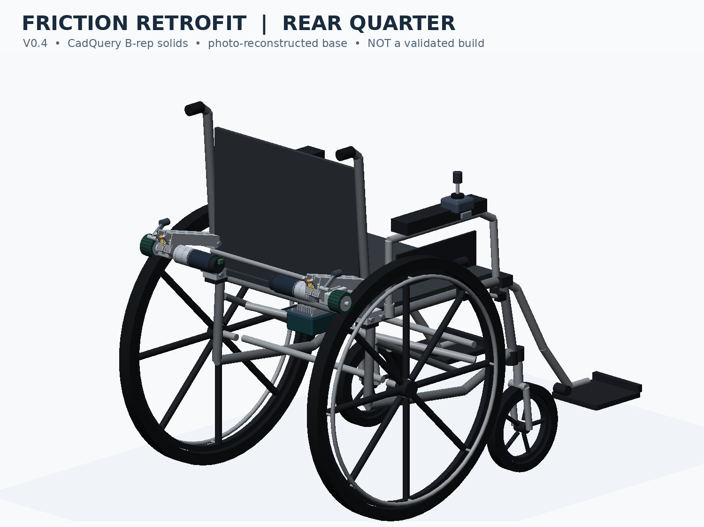
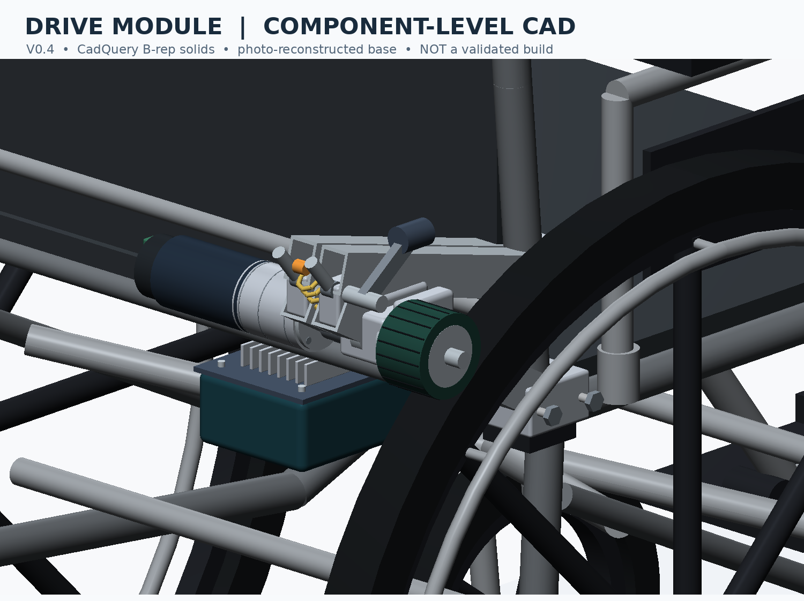

# Wheelchair Motorization — DIY Friction Drive

A low-cost, open-source way to add joystick-controlled movement to an existing manual wheelchair.

The idea is simple: instead of buying an entirely new powered wheelchair, attach two compact motors that drive the chair's **existing rear wheels** through rubber friction rollers. The project is focused on making an affordable design that anyone can study, build and improve, rather than selling a commercial product.

**Parts-cost target: about CAD $200**, excluding the wheelchair and tools.



## The design

- **Two friction-drive motors:** A roller presses against each rear tire, turning the left and right wheels independently.
- **Joystick steering:** Forward, reverse and turning use simple differential motor control.
- **Compact layout:** Motor modules sit by the rear wheels; battery and control hardware sit underneath the seat.
- **Removable installation:** Adjustable clamps and retractable rollers let the wheelchair return to manual pushing.
- **3D printing:** Custom covers, mounts, spacers and assembly guides can be printed, with metal parts used where loads demand it.
- **Common parts:** Motors, controllers, batteries and hardware are sourced from generic manufacturers, including Alibaba.

The first CAD reference is the **Drive Medical Cruiser III** with a 24-inch rear-wheel configuration.



## What's in this repository?

| Location | Contents |
|---|---|
| [`cad/`](cad/) | Parametric CadQuery source, compressed STEP/GLB assemblies, and printable STL concepts |
| [`reference/base_wheelchair_v02/`](reference/base_wheelchair_v02/) | Standalone CAD model of the original Cruiser III wheelchair |
| [`images/`](images/) | Renderings, assembly views, traction plots and stress visualizations |
| [`analysis/`](analysis/) | Propulsion, tire friction, motor-load and structural calculations |
| [`tests/`](tests/) | Automated geometry and physics checks |
| [`docs/RESEARCH.md`](docs/RESEARCH.md) | Suppliers, technical references and CAD research |
| [`docs/DESIGN_DECISIONS.md`](docs/DESIGN_DECISIONS.md) | Why each design approach was chosen |
| [`PROJECT_SPEC.md`](PROJECT_SPEC.md) | Project goals and engineering requirements |
| [`Cruiser_III_Engineering_Review_V04.pdf`](Cruiser_III_Engineering_Review_V04.pdf) | Full engineering report |

## Rebuild the CAD and tests

To restore the full-resolution STEP and GLB exports directly from the repository, run `python cad/restore_artifacts.py`. The original CAD files are reconstructed byte-for-byte.

To regenerate the parametric CAD and run the engineering tests, use Python and the dependencies in [`requirements.txt`](requirements.txt):

```bash
python -m pip install -r requirements.txt
python cad/build_high_fidelity.py
python -m unittest discover -s tests -p 'test_*.py' -v
```

## Development

The project is at the **CAD and engineering prototype stage**. The next work is to fit the design to a measured wheelchair, confirm selected components, and build an unoccupied test rig. The engineering report covers braking, traction and structural work needed before use by a person.
