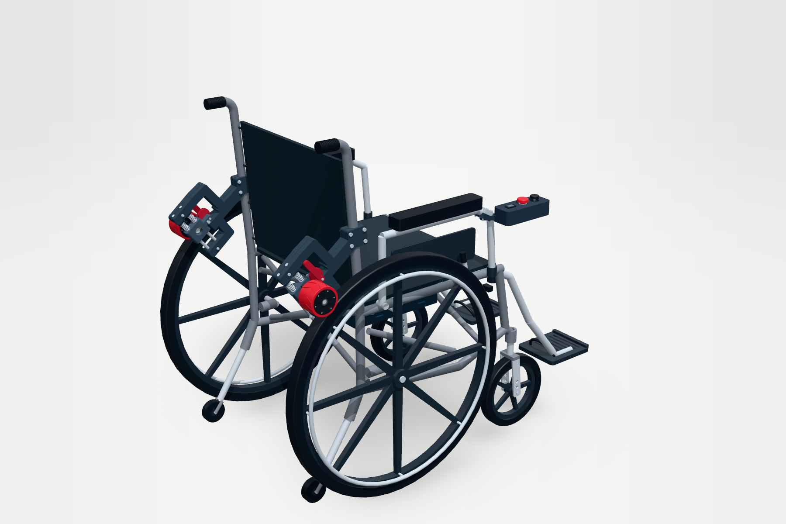
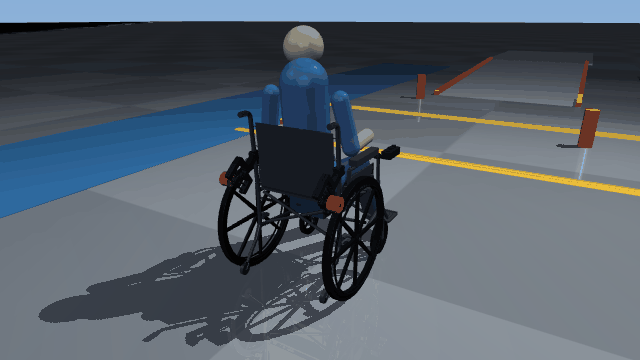
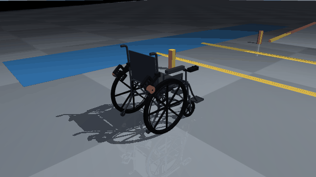
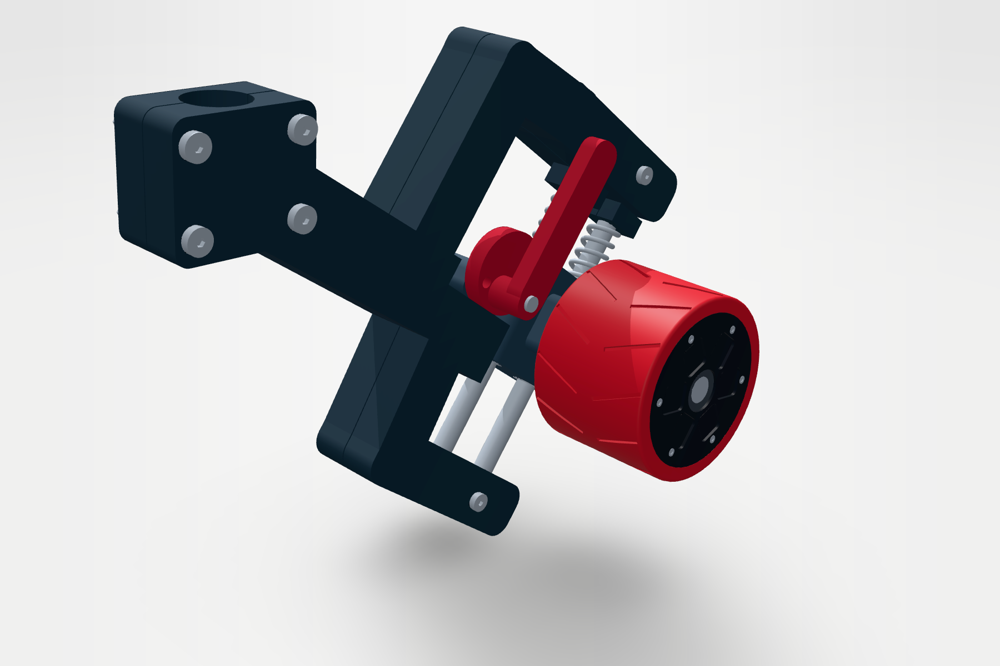
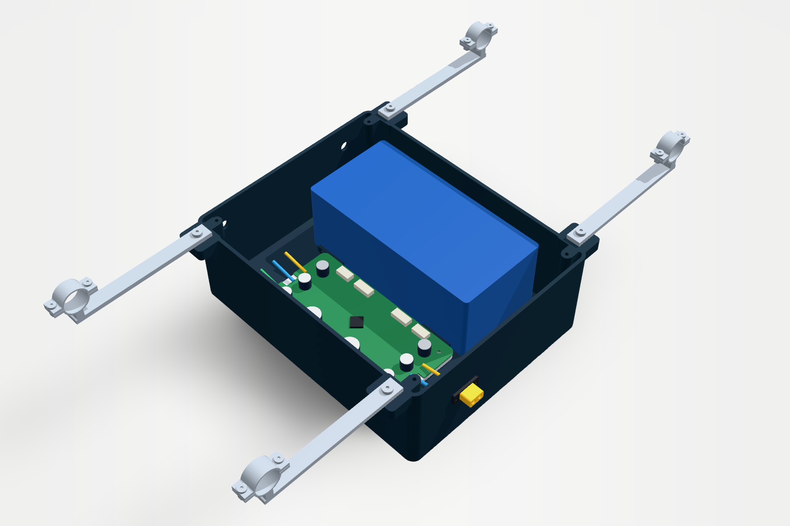
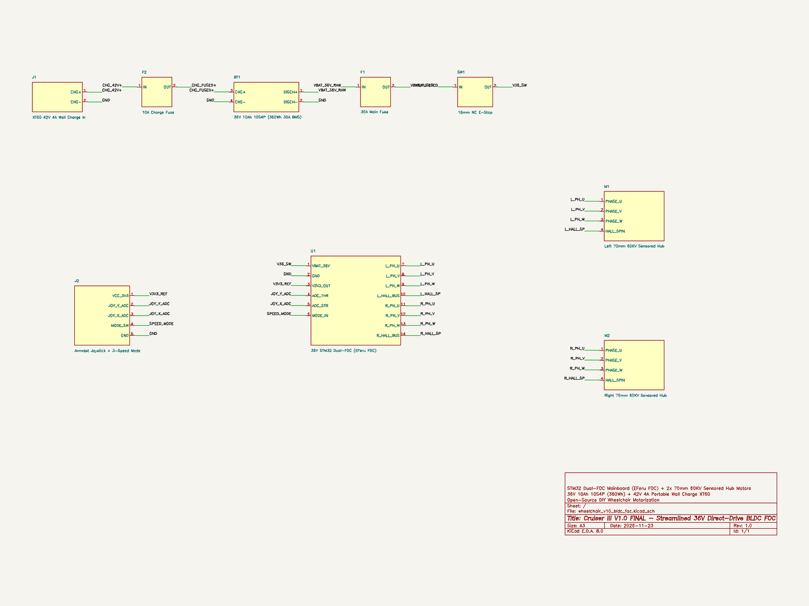
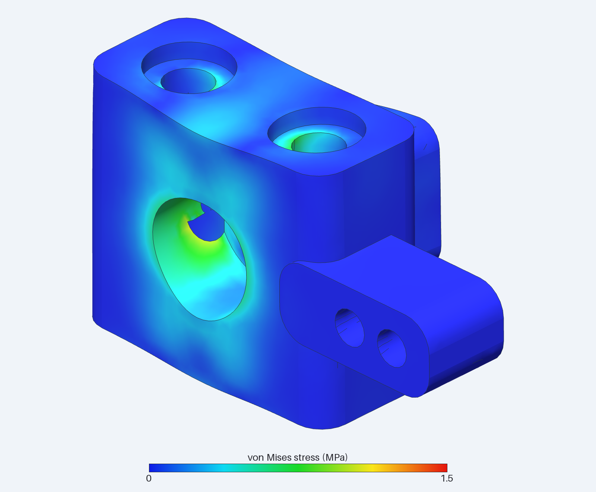
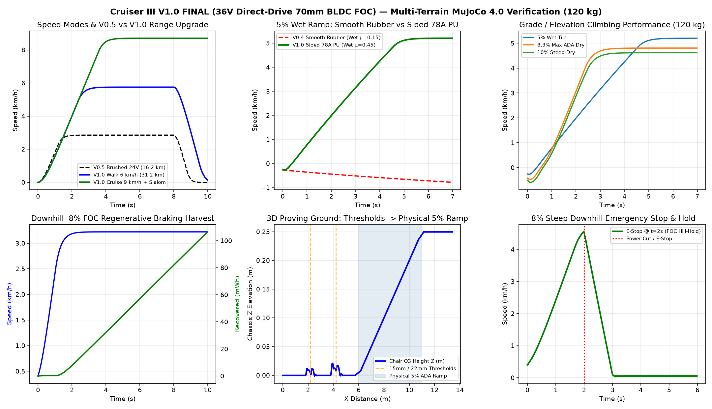

# Cruiser III V1.0 — Open-Source Direct-Drive BLDC Wheelchair Retrofit

An ultra-low-cost (**~$185 USD / ~$255 CAD**), reversible, bolt-on electric motorization kit for the **Drive Medical Cruiser III** manual wheelchair (18" seat / 24" rear wheels).

Instead of bulky gearboxes, pillow bearings, or custom machined metal brackets, **V1.0** uses **two 70 mm sensored BLDC skateboard hub motors** (with built-in replaceable 78A cast polyurethane sleeves and internal bearings), a **36 V STM32 Dual-FOC controller** (direct analog joystick input, whisper-quiet sinewave drive, downhill regenerative braking, electronic hill-hold), **six 3D-printed single-solid parts** (FEA-verified 46.5× safety factor), and a **compact 42 V 4 A portable wall charger** for fast away-from-home top-ups at any standard wall outlet.

<p align="center">
  
</p>

---

## Live Interactive Browser Simulator & 3D CAD Exploded View

- **Multi-World Driving Simulator (`sim/app.py`):** Test-drive the complete 120 kg loaded wheelchair right in your web browser—featuring a **natural 2D spring-return thumb joystick** (or **WASD / Arrow keys**), **Driver-Seat POV**, and **6 live-switchable worlds** (3D proving ground with beveled ADA thresholds & 5% ramp, 8.3% max ADA ramp, 10% steep driveway, wet 5% tile, -8% downhill regen, grass/gravel + 4% camber).
- **Standalone Animated 3D Exploded CAD (`cad/CruiserIII_V10_Exploded.glb`):** Interactive 383-part glTF/GLB assembly with a built-in 6-second smooth `explode` animation clip—open directly in `cad viewer` (text-to-cad), Windows 3D Viewer, Blender, or any web glTF viewer to scrub the explosion, inspect sub-assemblies, and measure clearances separately from the physics simulator.

| Proving Ground Drive Clip (MuJoCo 4.0) | Interactive 3D CAD Exploded View |
| :---: | :---: |
|  |  |

```bash
# 1. Launch the Multi-World Browser Driving Simulator
pip install -r requirements.txt
python sim/app.py
# Open http://localhost:8085/ in your browser

# 2. View the Interactive Animated 3D CAD Exploded Assembly (separate viewer)
cad viewer cad/CruiserIII_V10_Exploded.glb
```

---

## Key Performance & Engineering Highlights

| Metric | Specification | Verified By |
| :--- | :--- | :--- |
| **Core Kit Cost** | **~$185 USD (~$255 CAD)** (excl. shipping & wheelchair) | [BOM.md](BOM.md) |
| **Drivetrain** | 2× 70 mm × 50 mm 60 KV Sensored BLDC Hub Motors (built-in 78A siped PU sleeves) | Direct-drive (~85% eff., zero gearbox) |
| **Speed Modes** | **3.2 km/h** (Indoor) · **6.0 km/h** (Walk) · **9.0 km/h** (Outdoor Cruise) | Software-capped FOC + speed-sensitive steering |
| **Range & Battery** | **~24–31 km** flat (36 V 10 Ah 10S4P, 360 Wh, 30 A BMS) + downhill regen | MuJoCo 4.0 120 kg energy model |
| **Away-From-Home Charging** | **42 V 4 A Portable Wall Brick** (~168 W, ~350 g) → **+10–12 km/hr** at any wall outlet | Rear 10 A-fused XT60 port |
| **Grade & Wet Climbing** | **5% Wet Tile (5.2 km/h)** · **8.3% Max ADA (4.8 km/h)** · **10% Steep (4.6 km/h)** | MuJoCo 4.0 traction saturation suite |
| **Downhill Safety** | **FOC Regenerative Braking (+12.8 Wh/km on -8%)** + **Electronic Hill-Hold** + 44 mm Anti-Tippers | MuJoCo 4.0 -8% E-Stop hold test |
| **Structural Strength** | **1.50 MPa peak** / **46.5× safety factor** on PA-CF Hub Slider (320 N 2× dynamic load) | CalculiX 2.23 C3D10 3D FEA |
| **Reversibility** | Zero drilling/welding; 15 mm quick-release cam levers for 0-drag manual pushing | Exact CAD interference check (0° / 90° / 180°) |

---

## Visual Tour

### Mechanical Drive Module & Under-Seat Electronics Bay
| Direct-Drive 70 mm BLDC Module | Under-Seat 36 V Battery & Dual-FOC Bay |
| :---: | :---: |
|  |  |

### Electrical Schematic, 3D FEA Stress & Multi-Terrain Verification
| KiCad V1.0 Schematic (0 ERC Errors) | CalculiX 3D FEA — PA-CF Hub Slider (46.5× SF) |
| :---: | :---: |
|  |  |

<p align="center">
  
</p>

---

## Repository Structure

```text
.
├── README.md                              # Project overview, visuals & performance summary
├── BOM.md                                 # Order-ready Alibaba parts list, links, dimensions & print table
├── SETUP.md                               # Step-by-step printing, assembly, wiring, flashing & simulator guide
├── requirements.txt                       # Minimal Python dependencies for the browser simulator
├── cad/
│   ├── CruiserIII_V10_Exploded.glb        # Interactive animated 3D exploded glTF/GLB assembly (play/scrub in viewer)
│   ├── CruiserIII_V10_Full.step.gz        # Complete finished B-rep STEP assembly (gzipped)
│   └── stl/                               # 6 watertight, FDM-verified print-ready STL parts
├── electronics/
│   └── wheelchair_v10_bldc_foc.kicad_sch  # Self-contained, ERC-clean KiCad schematic (+ symbol library)
├── firmware/
│   └── eferu_foc_wheelchair_config.h      # Ready-to-flash EFeru FOC joystick & speed-mode configuration
├── media/                                 # CAD renders, FEA plot, schematic, benchmark chart & animated GIFs
└── sim/
    ├── app.py                             # Simplified browser driving simulator (2D joystick, WASD, live worlds)
    ├── worlds.py                          # 6 selectable worlds & Filament PBR Cruiser III V1.0 physics model
    └── meshes/                            # 9 aligned binary STL sub-meshes for 60 FPS browser rendering
```

---

## Safety & Prototype Notice

This is an open-source DIY engineering platform verified in CAD, linear static FEA, and multi-terrain MuJoCo simulation. **Always measure your physical wheelchair frame with calipers, verify purchased motor shaft flats and controller pinouts before final printing, and complete unoccupied weighted ramp/braking validation before occupied use.**

Licensed under the [MIT License](LICENSE).
